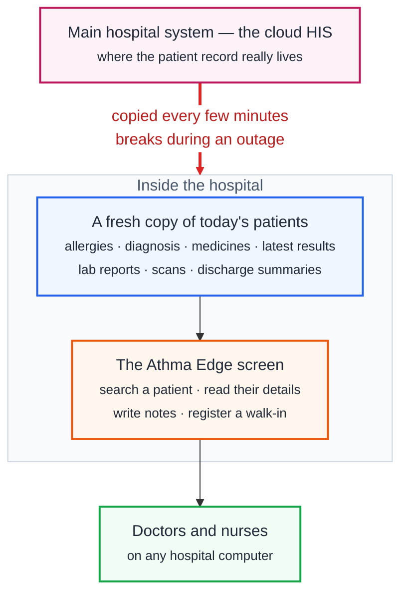

# Athma Edge — Hospital BCP Application

Local clinical continuity layer for hospitals. When the main cloud HIS/EMR becomes unreachable, clinical staff use Athma Edge to access active patient data, record clinical notes, and register walk-in patients.

## How It Works



**In one sentence:** Athma Edge quietly keeps a copy of today's patients on a server inside the hospital, so that when the cloud system goes down, staff can still look patients up and write things down.

Only the red arrow breaks during an outage. Everything inside the box sits on the hospital's own network and keeps running.

### What staff can and cannot do during an outage

| They can | They cannot |
|----------|-------------|
| Look up any patient who was active before the outage | Find a patient who was never synced |
| Read allergies, diagnosis, medicines, recent results | See anything that happened after the link went down |
| Open lab reports, scans and discharge summaries | Get results issued during the outage |
| Write clinical notes — orders given, assessments, handover | Place a real order; a note is a record, not an instruction to the pharmacy or lab |
| Register a walk-in patient who isn't in the system | Delete anything, or edit a note once saved |

Everything written during an outage goes back into the main system afterwards. See the [Business Continuity Plan](docs/runbooks/BUSINESS-CONTINUITY-PLAN.md) for how that works and who is responsible.

## What This IS

- Local cache of active patient data synced from the source HIS
- BCP Clinical Notes — append-only clinical documentation during outages (orders, medications, assessments, handover notes, etc.)
- BCP Temporary Patient Registration — walk-in patients who don't exist in the synced data
- Business Continuity Plan (BCP) tool for network outages
- Synced from source HIS via n8n workflows
- Deployed on a hospital edge box via Docker Compose

## What This is NOT

- Not a Disaster Recovery system
- Not a full EMR/HIS replacement
- No structured order entry, medication prescribing, or billing — clinical notes are free-text documentation only
- Not a real-time two-way sync — write-back to the HIS happens after recovery, through a separate n8n reconciliation workflow
- Not designed for internet-facing deployment

## Architecture

```
    Source HIS (cloud)
           │  n8n sync, 30s-10min
           ▼
  ┌─────────────────────────────────────────────────┐
  │  Hospital edge server (Docker Compose)          │
  │                                                 │
  │   PostgreSQL 16 ──────┐                         │
  │   (bcp_db)            ▼                         │
  │                  NestJS API  :3100 ◄──┐         │
  │   PDF storage ────────┘               │ /api/*  │
  │                                       │         │
  │             Nginx :80 ────────────────┘         │
  │             + the built SPA, served from disk   │
  └────────────────────────┬────────────────────────┘
                           │  hospital LAN
                           ▼
                  Clinical workstations
```

Nginx is the entry point: it routes `/api/*` to the NestJS API and serves the built single-page app for everything else. There is no separate UI server process.

**Services**: PostgreSQL 16, NestJS API, n8n (sync/ETL), Nginx (reverse proxy + static SPA) — four containers

## Prerequisites

- Docker and Docker Compose v2
- (For local dev without Docker) Node.js 20+, PostgreSQL 16

## Quick Start

```bash
# 1. Clone and configure
cp .env.example .env
# Edit .env with your settings (especially JWT_SECRET)

# 2. Start all services
docker compose up -d

# 3. Run database migrations
docker compose exec bcp-api npx prisma migrate deploy

# 4. Seed default data (roles + admin user)
docker compose exec bcp-api npx prisma db seed

# 5. Access the application
# UI:  http://localhost
# API: http://localhost/api/health
# n8n: http://localhost:5678
```

## First Login

**There are no default passwords.** Both were removed deliberately; anything you may have seen published here before does not work.

| Service | Username | Password |
|---------|----------|----------|
| BCP App | `admin` | Set `ADMIN_BOOTSTRAP_PASSWORD` in `.env` before seeding, or copy the one-time random password the seed prints |
| n8n | `${N8N_USER}` (default `admin`) | `N8N_PASSWORD` in `.env` — required, the stack refuses to start without it |

The seed prints the generated password exactly once and never stores it in plain text. If you miss it, re-seed a fresh database or reset the hash on the `bcp_user` row.

Change the admin password through **User Management** after first login, and create named accounts for clinical staff rather than sharing `admin`.

## Roles

| Role | Access |
|------|--------|
| DOCTOR | Patient search, clinical profiles, PDF documents, clinical notes, temp patient registration |
| NURSE | Patient search, clinical profiles, PDF documents, clinical notes, temp patient registration |
| ADMIN | All of above + user management, sync status, audit log |

## Care Settings

| Setting | Rollover Rule |
|---------|---------------|
| INPATIENT | Stays active until discharge |
| OUTPATIENT | Marked inactive at midnight (daily rollover) |
| DAYCARE | Marked inactive at midnight |
| EMERGENCY | Marked inactive at midnight |

## Sync Frequencies

| Workflow | Interval | Description |
|----------|----------|-------------|
| Active Patient | 60s | Upserts patient demographics and visit data |
| Clinical Profile | 2 min | Syncs vitals, meds, investigations for active patients |
| PDF Documents | 10 min | Downloads new/changed PDFs with checksum dedup |
| Daily Rollover | Midnight | OP/DC/ER soft-deactivation, IP date rollover |

## n8n Workflow Import

1. Open n8n at http://localhost:5678
2. Go to Workflows > Import from File
3. Import each JSON from `n8n/workflows/`
4. Configure database credentials for your source HIS and the BCP database
5. Activate the workflows

## Development (Without Docker)

```bash
# Backend
cd backend
npm install
npx prisma generate
npx prisma migrate dev
npx prisma db seed
npm run start:dev

# Frontend (separate terminal)
cd frontend
npm install
npm run dev
```

Backend runs on http://localhost:3100, frontend on http://localhost:3000.

## Project Structure

```
athma-edge/
├── CLAUDE.md / AGENTS.md    # AI agent operating contracts
├── docs/                     # Full documentation tree
├── backend/                  # NestJS API + Prisma
├── frontend/                 # React + Vite SPA
├── nginx/                    # Reverse proxy config
├── n8n/workflows/            # Sync workflow templates
├── init-scripts/             # PostgreSQL init scripts
└── docker-compose.yml        # Service orchestration
```

See [docs/README.md](docs/README.md) for complete documentation navigation.
